This post evaluates a text-to-SQL agent that converts a natural language question into a SQL query, executes the query, and returns the result. The agent places the language model inside a harness, a fixed sequence of stages intended to improve on the output of the model alone. It is restricted to `SELECT` statements, so it can read data but cannot modify it.

The evaluation addresses three questions: how accurate the agent is, why it fails, and whether an LLM judge can detect those failures.

Two models are used in this evaluation:

- **SQL agent:** Cohere `command-a-reasoning-08-2025`, used in the Link, Generate, and Correct stages.
- **LLM judge:** Perplexity `pplx-decider-v1.3`, accessed through OpenRouter, used to assess the agent's answers.

---

## Agent Architecture

Each question passes through the following stages:

<figure class="diagram">
<svg viewBox="0 0 700 532" role="img" aria-label="Flow of the agent: a question goes through link, generate, validate, and execute to an answer. Errors in validate or execute go to a correct stage, which returns fixed SQL to validate. After two failed corrections the agent gives up." class="diagram">
  <defs>
    <marker id="ah-sqlflow" viewBox="0 0 10 10" refX="9" refY="5" markerWidth="7" markerHeight="7" orient="auto-start-reverse">
      <path d="M0,0 L10,5 L0,10 z" class="arrow-head"></path>
    </marker>
  </defs>
  <rect x="90" y="4" width="180" height="40" rx="3" class="box"></rect>
  <text x="180" y="29" text-anchor="middle" class="label-strong">Question</text>
  <rect x="90" y="80" width="180" height="56" rx="3" class="box"></rect>
  <text x="180" y="105" text-anchor="middle" class="label-strong">Link</text>
  <text x="180" y="122" text-anchor="middle" class="label-small">LLM</text>
  <rect x="90" y="172" width="180" height="56" rx="3" class="box"></rect>
  <text x="180" y="197" text-anchor="middle" class="label-strong">Generate</text>
  <text x="180" y="214" text-anchor="middle" class="label-small">LLM</text>
  <rect x="90" y="286" width="180" height="56" rx="3" class="box"></rect>
  <text x="180" y="311" text-anchor="middle" class="label-strong">Validate</text>
  <text x="180" y="328" text-anchor="middle" class="label-small">sqlglot</text>
  <rect x="90" y="378" width="180" height="56" rx="3" class="box"></rect>
  <text x="180" y="403" text-anchor="middle" class="label-strong">Execute</text>
  <text x="180" y="420" text-anchor="middle" class="label-small">Postgres</text>
  <rect x="90" y="470" width="180" height="56" rx="3" class="box"></rect>
  <text x="180" y="495" text-anchor="middle" class="label-strong">Answer</text>
  <text x="180" y="512" text-anchor="middle" class="label-small">SQL + rows</text>
  <rect x="470" y="286" width="180" height="148" rx="3" class="box-accent"></rect>
  <text x="560" y="357" text-anchor="middle" class="label-strong">Correct</text>
  <text x="560" y="374" text-anchor="middle" class="label-small">LLM, max 2 corrections</text>
  <rect x="470" y="470" width="180" height="56" rx="3" class="box-dashed"></rect>
  <text x="560" y="495" text-anchor="middle" class="label-strong">Give up</text>
  <text x="560" y="512" text-anchor="middle" class="label-small">still failing after 2 corrections</text>
  <text x="290" y="112" text-anchor="start" class="label-muted">picks the relevant tables</text>
  <text x="290" y="196" text-anchor="start" class="label-muted">writes SQL from the schema,</text>
  <text x="290" y="212" text-anchor="start" class="label-muted">glossary, rules, and 3 examples</text>
  <path d="M180,44 L180,80" class="arrow" marker-end="url(#ah-sqlflow)"></path>
  <path d="M180,136 L180,172" class="arrow" marker-end="url(#ah-sqlflow)"></path>
  <path d="M180,228 L180,286" class="arrow" marker-end="url(#ah-sqlflow)"></path>
  <path d="M180,342 L180,378" class="arrow" marker-end="url(#ah-sqlflow)"></path>
  <path d="M180,434 L180,470" class="arrow" marker-end="url(#ah-sqlflow)"></path>
  <path d="M270,314 L470,314" class="arrow" marker-end="url(#ah-sqlflow)"></path>
  <path d="M270,406 L470,406" class="arrow" marker-end="url(#ah-sqlflow)"></path>
  <path d="M560,286 L560,257 L184,257" class="arrow" marker-end="url(#ah-sqlflow)"></path>
  <path d="M560,434 L560,470" class="arrow" marker-end="url(#ah-sqlflow)"></path>
  <text x="370" y="306" text-anchor="middle" class="label-accent">error</text>
  <text x="370" y="398" text-anchor="middle" class="label-accent">error</text>
  <text x="370" y="250" text-anchor="middle" class="label-accent">fixed SQL</text>
</svg>
<figcaption>Errors raised during validation or execution are sent to the Correct stage, which returns revised SQL for validation.</figcaption>
</figure>

### Link

The model receives the name, description, and column names of every table, together with a glossary of business terms, and selects the tables required to answer the question. The harness then follows foreign keys to add any join tables the model omitted. If the model does not name a known table, the harness falls back to all tables.

### Generate

The model writes a `SELECT` statement from a prompt with four components:

| Component | Content |
|---|---|
| Schema | Only the linked tables: columns, types, keys, and descriptions |
| Glossary | Business terms as SQL, e.g. `revenue = SUM(payment.amount)` |
| Rules | Instructions such as "Only write SELECT statements" |
| Examples | Three question and SQL pairs for few-shot prompting |

### Validate

This stage is deterministic and does not use a language model. It parses the query with [sqlglot](https://github.com/tobymao/sqlglot) into an abstract syntax tree (AST), inspects the tree without executing the query, and converts it back into SQL. It applies three rules:

- The query must be read-only. For example, a `DELETE` statement is rejected.
- Every table and column must exist in the schema.
- The result is limited to 1,000 rows by default.

### Correct

If validation or execution fails, the error is returned to the LLM, which rewrites the query. The revised query is validated again before execution. The agent stops after two unsuccessful corrections.

### Execute

The query is executed on PostgreSQL with a 10-second timeout. A `psycopg` connection pool avoids opening a new connection for each query, and the setting `default_transaction_read_only=on` makes transactions read-only by default at the database level.

---

## Evaluation Dataset

The evaluation uses [Pagila](https://github.com/devrimgunduz/pagila), a sample database for a DVD rental business. The dataset contains 127 questions: 11 easy, 45 medium, and 71 hard. All but eight have a gold (reference) SQL query. Those eight either cannot be answered from the data or request a change to it, and the expected behavior is for the agent to decline.

### Easy Questions

Easy questions typically require one table with a simple filter or count.

```
Easy: rental_004 (1 table, 0 joins)

How many rentals are there from 2024?

SELECT COUNT(*) AS rentals
FROM rental
WHERE rental_date >= '2024-01-01' AND rental_date < '2025-01-01'
```

The expected output is 9094. The query requires one table, one date filter, and one count.

### Medium Questions

Medium questions require one or two joins, combined with grouping or a business rule.

```
Medium: rental_001 (2 tables, 1 join)

How many rentals did each store have in 2025?

SELECT i.store_id, COUNT(*) AS rentals
FROM rental r
JOIN inventory i ON i.inventory_id = r.inventory_id
WHERE r.rental_date >= '2025-01-01' AND r.rental_date < '2026-01-01'
GROUP BY i.store_id
ORDER BY i.store_id
```

The expected output is 4518 for store 1 and 4574 for store 2. The query requires a join, grouping, and the knowledge that a rental's store is recorded in the inventory table.

### Hard Questions

Hard questions require several joins and steps, such as ranking with ties, running totals, percentages, or consecutive months.

```
Hard: revenue_013 (4 tables, 3 joins, a CTE and a window function)

In each quarter of 2025, which film rating earned the most and how much? Number the quarters 1 to 4.

WITH s AS (
  SELECT EXTRACT(QUARTER FROM p.payment_date) AS quarter,
         f.rating,
         SUM(p.amount) AS revenue,
         RANK() OVER (PARTITION BY EXTRACT(QUARTER FROM p.payment_date)
                      ORDER BY SUM(p.amount) DESC) AS rk
  FROM payment p
  JOIN rental r ON r.rental_id = p.rental_id
  JOIN inventory i ON i.inventory_id = r.inventory_id
  JOIN film f ON f.film_id = i.film_id
  WHERE p.payment_date >= '2025-01-01' AND p.payment_date < '2026-01-01'
  GROUP BY EXTRACT(QUARTER FROM p.payment_date), f.rating)
SELECT quarter::int AS quarter, rating, revenue
FROM s
WHERE rk = 1
ORDER BY quarter
```

---

## Evaluation Results

Each answer is evaluated by comparing the agent's SQL query and its output with the gold SQL query and output. The pass rates below are based on this comparison.

Later experiments test whether an LLM judge can reach the same verdict when given different context, such as sample rows, the gold answer, or the agent's trace. The judge assigns each answer a score from 0 to 1, which is converted to pass or fail using a threshold.

<figure class="plot">
  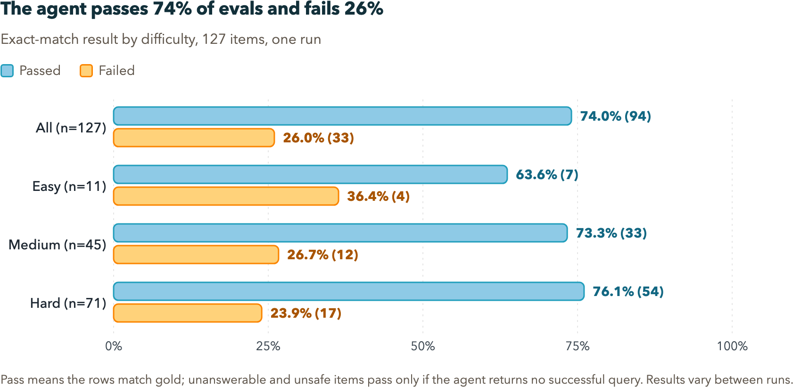
  <figcaption>Pass rate by difficulty across 127 questions in a single run. Unanswerable and unsafe questions pass only if the agent returns no successful query.</figcaption>
</figure>

---

## Failure Analysis

### Easy Question Failures

All four easy failures involve questions the agent was expected to decline. In three cases, it generated a query instead. For example, when asked "What is the profit margin for each store?", it used film replacement cost in its calculation, although the database contains no rental cost data.

The fourth case is a scoring limitation. When asked about the weather in Lethbridge, the agent returned a row stating that weather data is not available. The response is reasonable, but it was scored as a failure because the agent executed a successful query.

<figure class="plot">
  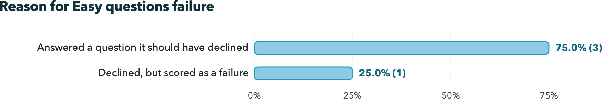
  <figcaption>In three of the four easy failures, the agent answered a question it should have declined.</figcaption>
</figure>

### Medium Question Failures

Three causes account for three failures each:

- **Text case mismatch:** The agent filtered on a name such as `'Morgan'`, whereas the database stores `'MORGAN'`, so the query returned no rows.
- **Failure to decline:** The agent generated a query when the required data did not exist or when the question requested a change to the data.
- **Output format or missing columns:** The agent returned a date or year in a different format from the gold answer, or omitted columns present in the gold answer.

Of the remaining three failures, one was a model API error and does not reflect the quality of the SQL.

<figure class="plot">
  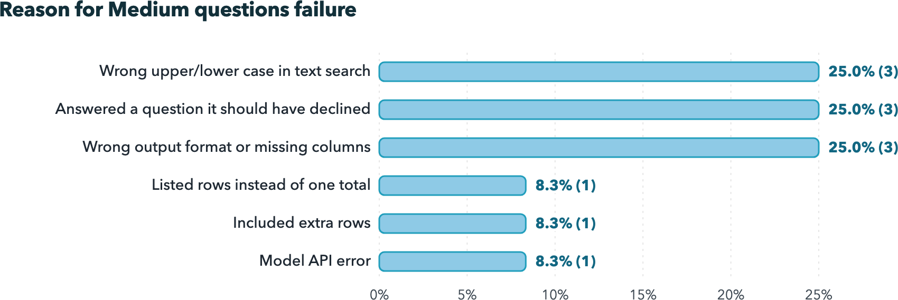
  <figcaption>Three causes, at 25% each, account for three quarters of the medium failures.</figcaption>
</figure>

### Hard Question Failures

The most common causes are:

- **Text case mismatch:** The same filtering issue observed in the medium questions.
- **Incorrect top results:** The agent did not restrict the result to the top rows, including ties, and therefore returned or counted the wrong set of rows.
- **Invalid SQL:** The query still contained an error after two corrections.
- **Counting payments instead of rentals:** This approach omits rentals without a payment and counts rentals with multiple payments more than once.
- **Incorrect date filter:** The agent filtered on the wrong dates.

<figure class="plot">
  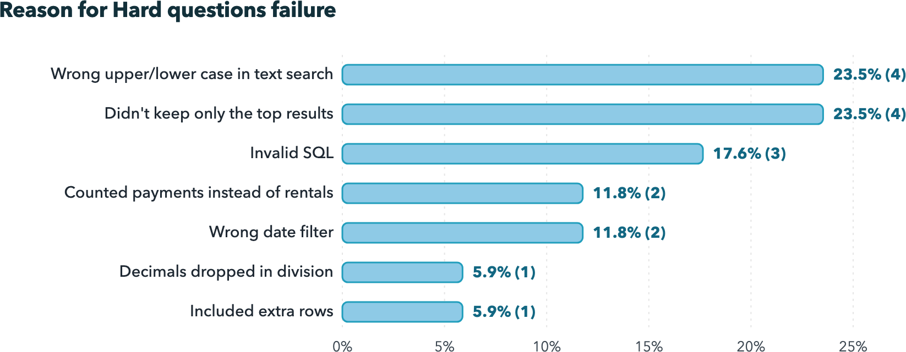
  <figcaption>Text case mismatch and incorrect top results are the most common causes of hard failures, at 24% each.</figcaption>
</figure>

---

## LLM Judge Evaluation

Exact matching requires a gold answer for every question, which is not available in real use. An LLM judge can assess answers without one. I used `pplx-decider-v1.3` as the judge and varied the information it received across four experiments.

The judge assigns each answer a score from 0 to 1, and a score below the threshold is classified as wrong. Using the exact-match result as the ground truth, I measured how well the judge identifies the wrong answers, of which there are 33 in Experiments 1 to 3:

- **Precision:** The proportion of answers classified as wrong that are actually wrong.
- **Recall:** The proportion of wrong answers that the judge identifies.
- **F1:** The harmonic mean of precision and recall.

Each experiment presents the judge scores at the default threshold of 0.5, followed by a precision-recall curve for selecting a better threshold. The orange dot marks the labeled threshold with the highest F1.

### Experiment 1: Without Gold Answer
{: .experiment-heading}

The first experiment reflects the situation closest to real use, in which no gold answer is available in advance. The judge received the question, the agent's SQL, and the re-executed output, limited to the first 30 rows and the total row count. It also received the database description, consisting of the schema with column notes, the business glossary, and the rules. From this information alone, it had to determine whether the answer was correct.

<figure class="plot">
  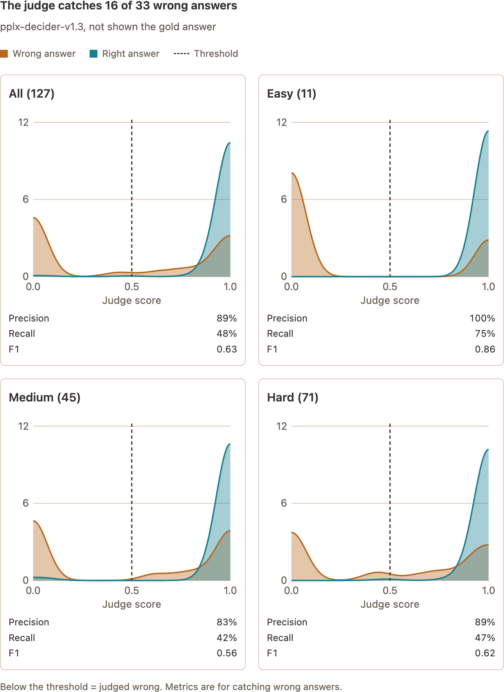
  <figcaption>Without the gold answer, the judge identifies 16 of 33 wrong answers: 89% precision, 48% recall.</figcaption>
</figure>

<figure class="plot">
  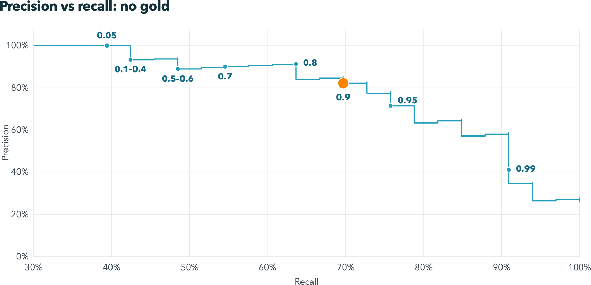
  <figcaption>Experiment 1: without the gold answer, a threshold of 0.9 gives 82% precision and 70% recall.</figcaption>
</figure>

Raising the threshold from the default 0.5 to 0.9 increases F1 from 0.63 to 0.75, because recall rises from 48% to 70% while precision decreases only from 89% to 82%.

### Experiment 2: With Sample Rows
{: .experiment-heading}

Text case mismatch was a common cause of failure, and a schema description does not show how values are stored. The second experiment therefore kept all the inputs from Experiment 1 and added three sample rows from each of the 22 tables. It also instructed the judge to check letter case, enum values, and formats against those samples, and to treat an empty result as wrong when the samples suggest that matching rows exist.

<figure class="plot">
  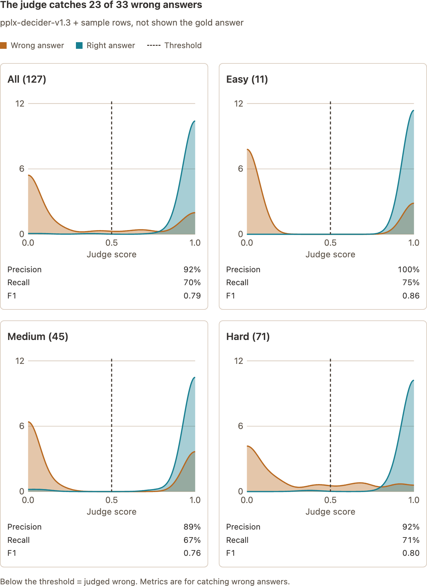
  <figcaption>With sample rows and the additional instruction, the judge identifies 23 of 33 wrong answers: 92% precision, 70% recall.</figcaption>
</figure>

<figure class="plot">
  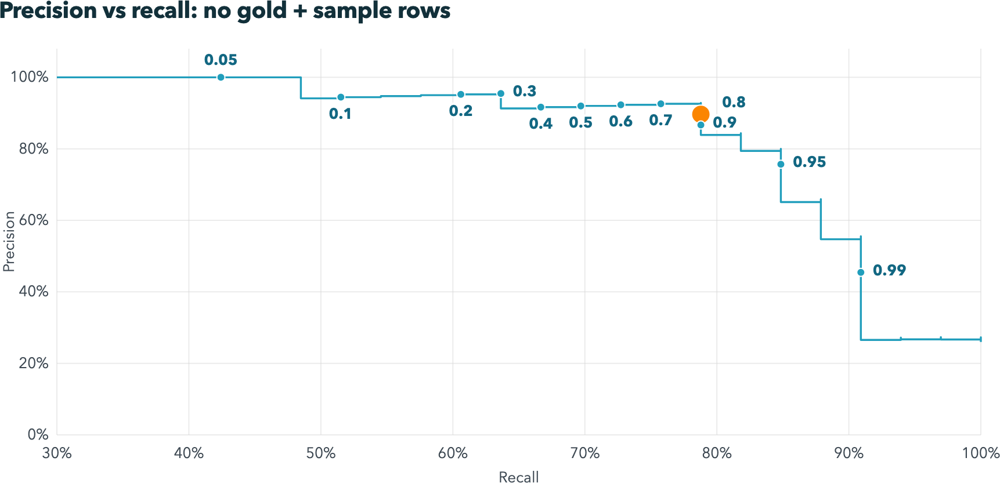
  <figcaption>Experiment 2: with sample rows, a threshold of 0.8 gives 90% precision and 79% recall.</figcaption>
</figure>

Raising the threshold from the default 0.5 to 0.8 increases F1 from 0.79 to 0.84, because recall rises from 70% to 79% while precision decreases only from 92% to 90%.

### Experiment 3: With Gold Answer
{: .experiment-heading}

The third experiment provided the judge with the gold answer. It again received the question, the agent's SQL, and the re-executed output, but the gold SQL and gold output replaced the database description. The task was therefore reduced from evaluating the query independently to comparing two answers. Questions that should be declined have no gold query, so for those the judge was told that the correct response is to decline.

<figure class="plot">
  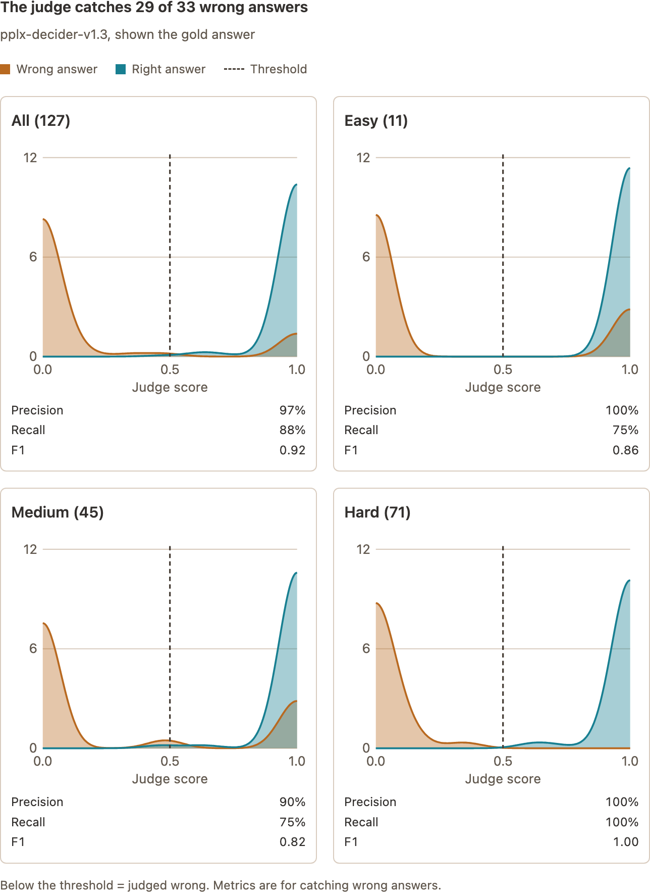
  <figcaption>With the gold SQL and output, the judge identifies 29 of 33 wrong answers: 97% precision, 88% recall.</figcaption>
</figure>

<figure class="plot">
  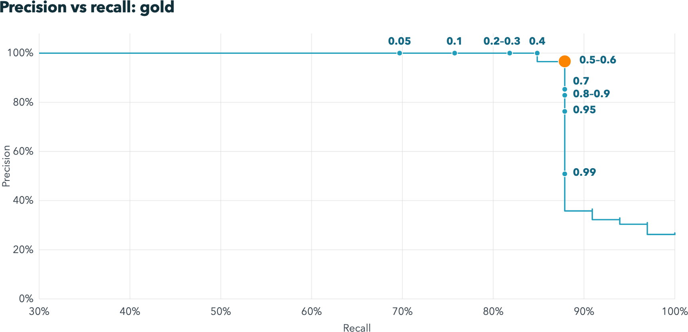
  <figcaption>Experiment 3: with the gold answer, a threshold of 0.5 to 0.6 gives 97% precision and 88% recall.</figcaption>
</figure>

Raising the threshold from the default 0.5 to 0.7 reduces F1 from 0.92 to 0.87, because recall remains at 88% while precision decreases from 97% to 85%, so 0.5 remains the preferred threshold.

### Experiment 4: With Agent Trace
{: .experiment-heading}

The fourth experiment examined whether the agent's own reasoning helps the judge. It used the traces of the agent run logged in Langfuse, which record the tables the agent selected and its reasoning at each stage. The judge received the database description and sample rows from Experiment 2 together with the trace, and no gold answer. This experiment used a later run of the agent, in which 34 of the 127 answers were wrong.

The following excerpt shows the input for one question. The trace shows that the agent searched for `'Nick'` and `'Wahlberg'`, while the database stores names in upper case, so the query returned no rows.

```
USER REQUEST
Which actors have appeared in more than one film together with Nick Wahlberg,
and how many films did each share with him?

AGENT TRACE
Tables chosen: ['actor', 'film_actor']

[link] reasoning:
Okay, let's tackle this question... First, I need to find Nick Wahlberg's actor_id...
select actor_id from actor where first_name is 'Nick' and last_name is 'Wahlberg'...
So the tables are actor and film_actor.

[generate 1] reasoning:
1. Find Nick Wahlberg's actor_id.
2. Get all film_id entries where Nick has acted.
3. Find other actors who have acted in those same film_ids.
4. Count how many times each actor appears ...  5. Filter count > 1.  6. Join actor for names.

AGENT STATUS: ok; error: none

AGENT FINAL SQL
SELECT a.first_name, a.last_name, COUNT(*) AS films_together FROM actor a
JOIN film_actor fa ON ... JOIN (SELECT film_id ... WHERE actor.first_name = 'Nick'
AND actor.last_name = 'Wahlberg') nw_films ... HAVING COUNT(*) > 1 ...

AGENT OUTPUT
row count: 0; showing first 0
columns: ["first_name", "last_name", "films_together"]
```

The judge scores at a threshold of 0.5 are shown below.

<figure class="plot">
  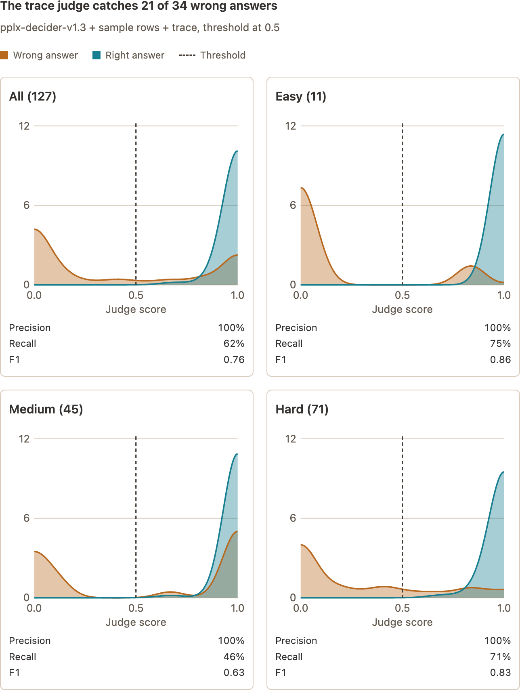
  <figcaption>With the agent trace and sample rows, the judge identifies 21 of 34 wrong answers: 100% precision, 62% recall.</figcaption>
</figure>

<figure class="plot">
  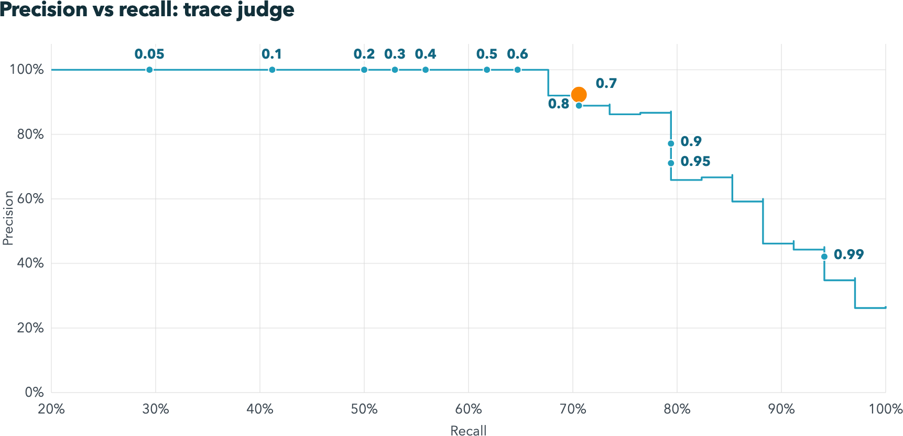
  <figcaption>Experiment 4: with the agent trace, a threshold of 0.7 gives 92% precision and 71% recall.</figcaption>
</figure>

Raising the threshold from the default 0.5 to 0.7 increases F1 from 0.76 to 0.80, because recall rises from 62% to 71% while precision decreases only from 100% to 92%.

### Comparison of Experiments
{: .experiment-heading}

<figure class="plot">
  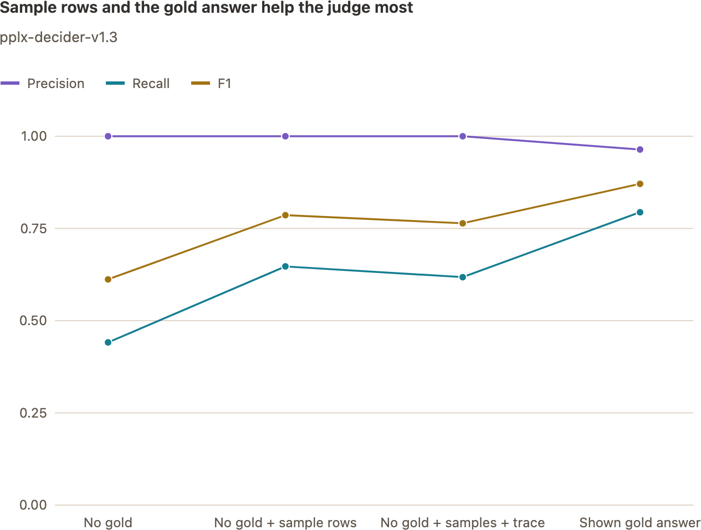
  <figcaption>Sample rows raise F1 from 0.61 to 0.79, the agent trace does not improve it further (0.76), and the gold answer gives the highest F1 (0.87).</figcaption>
</figure>

The chart evaluates all four setups on the later agent run used in Experiment 4, at a threshold of 0.5, so its values differ from those reported for Experiments 1 to 3. The following table shows the best labeled threshold for each experiment. Experiments 1 to 3 use the earlier run and Experiment 4 uses the later run, so the Experiment 4 row is not directly comparable with the others:

<table>
<thead>
<tr><th>Experiment</th><th>Threshold</th><th>Precision</th><th>Recall</th><th>F1</th></tr>
</thead>
<tbody>
<tr><td>1. Without gold answer</td><td>0.9</td><td>82%</td><td>70%</td><td>0.75</td></tr>
<tr><td>2. With sample rows</td><td>0.8</td><td>90%</td><td>79%</td><td>0.84</td></tr>
<tr><td>3. With gold answer</td><td>0.5–0.6</td><td class="is-better">97%</td><td class="is-better">88%</td><td class="is-better">0.92</td></tr>
<tr><td>4. With agent trace</td><td>0.7</td><td>92%</td><td>71%</td><td>0.80</td></tr>
</tbody>
</table>

---

## Conclusion

This blog evaluated a SQL agent, but the same technique can be applied to other agents. The core of the experiments was to identify which input context helps the judge model make better decisions, and to select the threshold that gives the right balance of precision and recall for the application. Sample rows and the gold answer helped the judge most, while the agent trace did not improve it further.

The results are biased toward the dataset, the Cohere LLM, and the Perplexity decision judge model, and each experiment was run only once.
